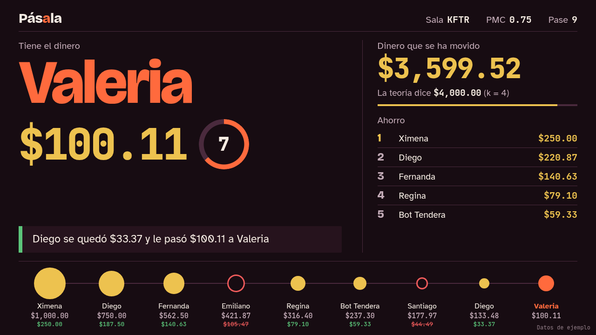
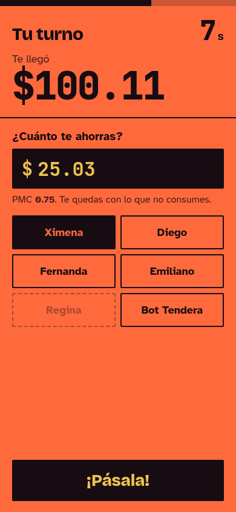

# Pásala: la papa caliente del dinero

Juego en vivo para la clase de Macroeconomía (IPN · UPIICSA) que acompaña la presentación **"El multiplicador de la inversión"**.
El dinero de una inversión rebota entre los celulares del salón. Quien lo recibe tiene 10 segundos para quedarse con su
ahorro y pasar el resto. Al final, el proyector compara cuánto se movió con la teoría: **ΔY = k × ΔI, con k = 1 / (1 − PMC)**.

| Proyector | Celular |
|---|---|
|  |  |

*Pantallas de referencia del diseño, con datos de ejemplo (PMC 0.75, $1,000).*

## Cómo se juega

1. El presentador abre `/host.html` en la computadora del proyector. Aparecen el código de la sala y un QR.
2. Los alumnos escanean el QR (o entran a la página y escriben el código) y ponen su nombre.
3. El presentador elige el caso de la diapositiva y presiona **¡Arrancar!**

   | Caso | Inversión | PMC | k | Teoría |
   |---|---:|---:|---:|---:|
   | Leñeras y carpinteros | $1,000 | 2/3 | 3 | $3,000 |
   | Ejercicio 1 | $1,000,000 | 0.50 | 2 | $2,000,000 |
   | Ejercicio 2 | $1,000,000 | 0.75 | 4 | $4,000,000 |

4. A quien le cae el dinero escribe cuánto se ahorra (ingreso × (1 − PMC), con tolerancia de ±$0.50) y elige a quién pasarle el resto.
5. Si se equivoca o se le acaba el tiempo, pierde ese ahorro, pero el dinero siempre sigue con el monto correcto.
6. La cadena termina cuando queda menos de $1 o el presentador presiona **Terminar ahora**. Gana quien ahorró más.

## Correrlo en tu computadora

Necesitas Node.js 20 o más nuevo.

```bash
npm ci          # instala dependencias
npm start       # http://localhost:3000 (usa PORT=4000 npm start para otro puerto)
npm test        # pruebas de la lógica, las salas y los sockets (node:test)
```

Para probar sin 30 personas, en el lobby presiona **Agregar 5 bots**.
Las pantallas también funcionan sin servidor de juego con estados de ejemplo: `/host.html?mock=playing`, `/play.html?mock=myturn`
(`lobby`, `playing`, `myturn`, `passed`, `final`).

### Pruebas en navegador

```bash
npx playwright install chromium     # una sola vez
npx playwright test                 # proyector a 1280×720 y celular a 390×844, con movimiento reducido
```

### Prueba de carga: 30 celulares

```bash
node test/load-test.js --local --players 30 --games 3          # contra un servidor en tu máquina
node test/load-test.js https://TU-SERVICIO.onrender.com         # contra Render
```
Reporta la latencia promedio y p95 entre la jugada y el siguiente estado. La meta es menos de 300 ms y cero desconexiones.

## Desplegar en Render

El repo ya trae `render.yaml` (Blueprint): servicio web Node, `npm ci`, `npm start`, health check en `/health`, una instancia.

1. Entra a [Render](https://render.com) con tu cuenta de GitHub.
2. **New → Blueprint** y elige este repositorio. Render lee `render.yaml` y crea el servicio `pasala`.
   (Sin Blueprint: **New → Web Service**, runtime Node, build `npm ci`, start `npm start`, health check `/health`).
3. Espera el deploy y abre `https://pasala-xxxx.onrender.com`. El QR usa esa URL solo (`RENDER_EXTERNAL_URL`).
4. Corre la prueba de carga contra esa URL.

Cosas a cuidar:
- **Una sola instancia.** El estado vive en la memoria del servidor; no actives autoscaling.
- **El plan gratis se duerme** tras 15 minutos sin tráfico y tarda cerca de un minuto en despertar. Abre la página del presentador 5 minutos antes de la clase.
- **No despliegues durante la clase:** un deploy reinicia el servidor y borra las salas. `autoDeploy` está activo, así que no hagas push a `main` en ese rato.

## Checklist del día de la clase

- [ ] Abrir `/host.html` 5 minutos antes (despierta el servidor).
- [ ] Proyectar y verificar que el QR se lee desde el fondo del salón.
- [ ] Elegir el caso que coincide con la diapositiva que se acaba de explicar.
- [ ] Ronda de práctica de 1 minuto.
- [ ] Dos rondas: PMC 0.50 y PMC 0.75, y comparar cuánto se movió en cada una (k = 2 contra k = 4).
- [ ] Cerrar con la pantalla final: lo que se movió ≈ k × inversión.

## Plan B

1. **Falla el Wi-Fi o Render:** corre `npm start` en la laptop, comparte internet desde tu celular (hotspot) y que los alumnos entren a `http://IP-DE-TU-LAPTOP:3000`. El QR se genera con esa dirección.
2. **Falla todo:** el video del flujo completo (lo graba el presentador antes de la clase).

## Cómo está hecho

- **Servidor** (`server.js`, `src/`): Express + Socket.IO. El servidor es la única fuente de verdad: elige al primero, lleva el reloj de cada turno, valida la cuenta y decide a quién pasa el dinero. Los celulares solo muestran el estado y mandan su jugada.
  - `src/game.js`: la lógica pura del juego, con sus pruebas.
  - `src/rooms.js`, `src/validate.js`: salas de 4 letras, nombres limpios, límites, reconexión con un token secreto.
  - `src/socket-lobby.js`, `src/socket-game.js`: los eventos de Socket.IO.
  - `src/bots.js`: jugadores de prueba que aciertan el 85 % de las veces.
- **Pantallas** (`public/`): HTML, CSS y JavaScript sin framework ni paso de build. Diseño en `docs/DESIGN.md`; todos los colores salen de `public/css/tokens.css`.
- **Especificación completa:** `IDEA.md`.
